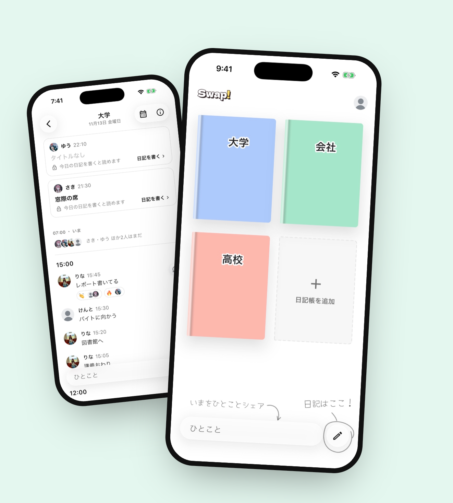

## 👋 About Me

- 📱 Flutter / Dart を中心にアプリを開発しています

## 🚀 Featured Project

  

<h3 align="center"><a href="https://yato789.com/apps/swap">Swap! — みんなで書く交換日記アプリ</a></h3>

  <b>交換日記みたいに、みんなで1日の日記を共有しよう。</b> 
  「今なにしてる」のひとことと、1日の終わりの日記。 
  招待した友達とだけ、そっと交換できる iOS アプリです。

  
  

## 📫 Contact

  
  <!-- 例: X / Zenn / Qiita のバッジ。使う場合はコメントを外して URL を書き換えてください
  
  
  -->

